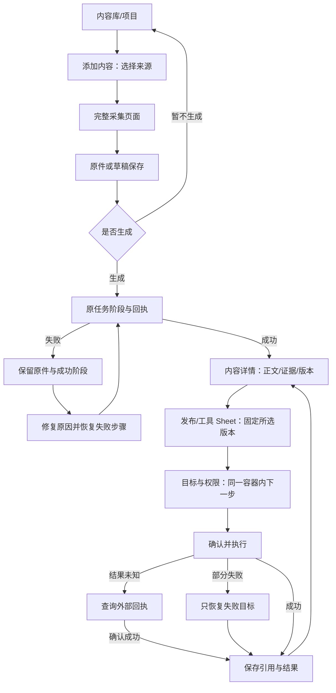

# 导航、容器与弹层重新规划

最新一级／二级导航以 [navigation-final.md](navigation-final.md) 为准（2026-10-11 用户再次要求明确规划）。本文保留过程方案与验证记录；早期主导航不再作为实施依据。

状态：2026-10-11 用户已授权使用选定 Skill 实施两端改造。下文保留重规划提案，文末记录本轮实际落地与验证边界；提案中的收藏、固定项目等未实现内容不能视为现有功能。保留此前确认的权限与原件保留契约。

## 选用的设计指导

- UI UX Pro Max：导航层级、返回语义、平台差异。已安装并实际查询导航/返回；弹窗检索仅返回焦点规则，不能声称找到完整嵌套弹窗方案。弹层分工由下面的产品契约明确。
- ibelick baseline-ui：复用当前 Radix/shadcn 基础组件，统一间距、层次、空状态和错误位置。React Native 使用已有原生组件和 Animated，不把 Web 的 Tailwind/Motion API 搬到手机。
- ibelick fixing-accessibility：对话框内初始焦点、焦点约束、关闭恢复触发点、Escape、表单错误关联。
- ibelick fixing-motion-performance：只在小范围反馈中使用 transform/opacity，循环动效在不可见/后台时停止，不增加动画库，不持续动画大面积模糊。
- 本轮不启用 improve-ui（只读审计/交接，与当前整体重规划及后续实现不同）；不启用 create-design-md（当前被拒绝的旧界面不可提炼成新的规范）；网站 SEO metadata 与应用内流程无关。

## 一、导航按内容对象组织，采集和处理按流程组织

旧分类的问题：工作空间、本机录制、处理记录分别代表对象容器、输入动作和执行状态，层级不同；会议和原件又同时出现在两份列表，用户不知道哪一份是主记录。

提议的桌面结构：

```text
当前空间（个人/已加入团队）
全局查找

内容
  内容库          所有笔记/会议/总结，唯一主列表
  项目            组织同一批内容；项目详情是内容库的过滤视图
  收藏            用户显式收藏的内容视图（尚需实现持久收藏）

常用项目          用户固定的项目快捷入口；无项目时隐藏

任务状态          生成/同步/交付/工具的待处理数量；打开任务面板
连接与工具        飞书官方连接 + 可选 MCP
设置              模型、录制偏好、外观、数据与同步、关于
账号菜单          个人资料、账号操作、当前客户端退出
```

内容库中的会议/文字/音视频属于内容类型筛选，不能再成为第二套顶层导航。归档、回收站属于内容生命周期视图，不能混同空间切换。项目不是团队，收藏不是同步副本。

内容库页只有一个“添加内容”操作入口，展开来源选择后进入完整采集流程；不再在导航、顶部栏和页面正文重复放同一操作。录音、录屏、文件、链接、文字是不同采集方式，不能用一个“新建”按钮替代解释，也不能把四个方式永久挤在侧边栏。

正在录制的状态独立于页面导航，通过唯一悬浮控制器/手机迷你控制条继续操作。完成或待生成的原件与其内容记录关联；无纪要时记录仍存在。设备历史只能作为“本机原件”视图，不再与内容库重复展示两套会议结果。

任务状态是运行反馈；任务面板内保留“查看全部”进入有深链的任务中心。账号、团队、飞书授权和 MCP 凭证分别拥有自己的边界。

App 提议底部导航：内容、项目、我的。任务状态是页头状态入口；采集从内容页主操作进入；录制控制条独立保留。不把桌面侧边栏完整复制到底部。

项目导航可基于已有项目元数据扩展，但当前只是分类字段；收藏还没有已验收的持久接口。不能把这些提案描述为可用功能。正式实现前给出每个入口对应的页面、数据归属和空状态。

## 二、每类容器的唯一职责

| 容器 | 放什么 | 不放什么 | 正常/失败/重试 |
| --- | --- | --- | --- |
| 应用壳 | 空间、导航、全局状态 | 内容正文、模型表单 | 壳保持稳定，页面错误不让导航消失 |
| 页面标题区 | 返回、标题、一个主动作 | 第二个搜索、重复主动作 | Loading 和失败仍保留父级返回 |
| 列表工具区 | 当前列表搜索、类型/项目筛选 | 全局设置 | 查询空结果允许清除条件，不等同服务失败 |
| 内容列表 | 标题、来源、版本/状态、简短预览 | 长全文、媒体播放器 | 缓存可读；更新失败就地提示 |
| 内容阅读区 | 当前正文或对应版本证据 | 连接凭证配置 | 正文/逐字稿/对话分开，失败只重试当前资源 |
| 上下文侧栏/抽屉 | 来源、版本、当前对象属性 | 全局账号/工具商店 | 按需展开，关闭恢复阅读位置 |
| 表单分区 | 一组有共同保存责任的字段 | 无关联配置 | 错误靠近字段，提交锁防重复，保留已输入内容 |
| 状态条 | 当前操作阶段、等待或恢复提示 | 长技术说明 | 未知结果先查回执，不伪造百分比 |
| 卡片 | 可独立选择的对象或独立配置单元 | 所有段落都套卡片 | Hover/Pressed/Selected/Disabled 有统一规则 |
| 固定控制区 | 播放/录制/必要提交操作 | 页面标题与全文 | 不遮盖正文，滚动区预留实际高度 |

## 三、弹层分类与层级

| 类型 | 场景 | 打开后行为 | 退出/返回 |
| --- | --- | --- | --- |
| Tooltip | 图标解释、快捷键 | 不承载按钮和表单，不夺焦点 | 离开触发点关闭 |
| Menu / Popover | 选项、筛选、短快捷操作 | 一次选择，触发点附近，键盘可用 | Escape 关闭并恢复触发点 |
| Sheet / Bottom Sheet | 单个对象预览、短设置、任务面板 | 保留页面上下文；唯一主滚动区 | 有未保存输入时走保护；不无条件关闭 |
| Dialog | 录制设备检查、单次明确操作 | 标题/说明/内容/操作固定分工，焦点在内部 | 可见取消/关闭，关闭恢复触发点 |
| AlertDialog | 删除原件、断开、丢弃未保存输入 | 说明影响和不可恢复范围，默认聚焦安全操作 | 取消回原容器，失败留在原确认上下文 |
| 完整页面 | 导入/生成、编辑、设置子页、长配置 | 保留深链、来源和草稿 | 显式上级，刷新/重进可恢复上下文 |
| 非模态悬浮控制 | 正在录制或播放 | 单一控制器，页面仍可用 | 收起不结束录音；结束先保存 |
| Toast | 已确认的短成功反馈 | 不夺焦点 | 自动消失；不能成为失败和未知结果唯一载体 |

仅允许一个任务型模态容器处于交互状态。飞书发布中选择目录、群、权限使用同一 Sheet 内的步骤切换，保留输入；不能叠加目录 Dialog → 群 Dialog → 权限 Dialog。复杂连接配置转完整页面。

允许的额外层：当前模态内的短下拉选项；保护未保存内容/危险操作的 AlertDialog。后者打开时下层不响应，关闭恢复到下层原焦点。第三层任务弹窗禁止。

Escape/Android 返回顺序：关闭短菜单 → 返回当前流程上一步 → 关闭无草稿的任务容器 → 有草稿则保护 → 返回页面父级。全局导航不能绕开未保存内容或未保存原件保护。

层级角色固定为页面、局部浮层、固定控制、任务模态、危险确认、短通知，不在页面中临时写任意 z-index。落地时统一对齐现有 Dialog/Sheet/Popover 原语的层级与焦点管理，而不是只提高数字。

## 四、关键交互闭环



## 五、实施前验收门槛

先完成新导航树与实际路由/数据对象映射，避免只把现有三项改名。再完成容器与弹层 inventory，标出每个宿主、打开条件、退出保护、请求所有者和恢复入口。之后逐页检查正常、空、读取失败、提交失败、未知结果、重试、前后台与深链返回。实现与完整实机验收分开记录。

## 六、本轮实际实施（2026-10-11）

### 导航与对象归属

桌面导航：内容组（内容库、项目）；当前设备组（本机原件）；服务组（任务与恢复、连接与工具）；底部设置和账号。App 底栏：内容、项目、我的。全局任务入口在三页都可进入，并返回进入前的页面；本机原件从内容或我的进入。详细流程页隐藏底栏。

内容库是唯一正文列表，单击直接进入详情，不再先显示预览再点击打开。项目读取现有 project 字段，项目详情是同一内容列表的过滤视图，不复制笔记。收藏和固定项目没有持久化契约，本轮未显示。桌面任务采用完整恢复页，复杂的同步、交付和工具结果不放短弹窗；本机原件保留直接入口，与内容库按对象分组。

本机原件只列本机待整理文件与通过真实 recording 元数据接口核验的已保留文件；不把所有完成纪要再复制成录音列表。已处理原件顺序读取元数据，不预载媒体，按 task_id 去重，文件缺失不伪造播放按钮；读取失败可单独重试。详情中的来源与全部版本改为按需侧层，正文不长期挤在左右两份内容之间。

### 页面分区与返回/恢复契约

| 页面 | 内容区域 | 返回 | 正常、失败、重试 |
|---|---|---|---|
| 内容库 | 单一标题/添加入口、局部搜索筛选、内容列表 | 一级页；归档返回内容库；项目视图返回项目 | 加载骨架；空数据引导添加；读取失败保留缓存并重试；单击进入详情 |
| 项目 | 标题、真实项目数量卡片 | 一级页；项目内容返回项目 | 独立加载/失败重读；无项目引导从内容分配项目，不伪造预设项目 |
| 本机原件 | 录制准备、待整理原件、已保留原件 | 内容库或实际来源 | 先保存再生成；保存失败不能假定成功；分析失败保留原件；录音元数据失败重读 |
| 导入整理 | 来源、确认、处理设置、提交状态 | 实际内容/原件来源 | 上传中保护当前页面；服务端接受后保留回执；结果保存失败恢复原结果，避免重新生成 |
| 内容详情/编辑 | 标题动作、正文/逐字稿/对话、按需来源版本层 | 保留项目/归档参数或任务来源 | 历史版本保持原证据；生成失败保留原版本；编辑草稿保存失败禁止把旧草稿视为新草稿已保护 |
| 任务与恢复 | 生成、同步、交付、工具各自状态 | 内容库或 App 原入口 | 分阶段恢复；不确定远端结果先查询；不自动重放有副作用的工具调用 |
| 连接与工具 | 飞书内置连接、MCP 可选扩展、交付说明 | App 我的；桌面一级页 | 配置缺失和网络故障区分；选定已保存版本后才发布/调用 |
| 飞书 | 账号、文档位置、权限、本人/群通知、保存状态 | 连接目录或实际任务来源 | 未配置明确提示；授权读取/保存失败保留草稿；目录失败保留位置并重读；按父目录逐级返回 |
| MCP | 折叠用途说明、连接列表/选中配置、运行记录 | 连接目录或实际内容来源 | 空态只提供一个添加主入口；添加失败保留表单；调用结果未知先检查外部结果 |
| 设置 | 分类导航、单一选中内容 | 子分类返回设置总览；设置返回内容库 | 分类与内容同步；模型/数据/账号分区；连接详情独立，避免在设置正文重复连接目录 |
| App 我的 | 账号、模型、数据、原件、连接、外观 | 一级页；子页返回我的或实际来源 | 退出保护未保存录音；缓存可读但不伪称连接成功；恢复错误可重试 |

### 容器与弹层 inventory

1. 主导航只负责空间、全局查找、对象入口和账号。页面标题只出现一次；局部搜索只过滤当前内容，不能导航到其它功能。
2. 列表容器管理筛选、加载、空态和读取错误；阅读容器管理正文；长配置放独立页面。取消长期空的“选中对象”右栏。
3. Dropdown/Select 为短选择层（55）；Tooltip 为提示层（70）；Sheet/Dialog 为单任务层（50）；AlertDialog 为确认层（60）。禁止通过不断增加 z-index 解决任务层堆叠。
4. 来源/版本侧层启动生成、比较、分类等任务前先关闭。飞书目录在当前任务内逐级浏览；App 同一个 BottomActionSheet 内切换步骤，返回先回前一步。
5. 退出账号、删除、离开受保护编辑使用确认层；任务失败保留原输入并在任务内显示重试。Toast 只反馈结果，不能承担恢复入口。
6. Desktop Radix 管理焦点约束/恢复，Ctrl K 不在现有任务弹层上叠加搜索。App 底层面板支持 accessibilityViewIsModal、系统返回/无障碍退出与 48dp 关闭目标。
7. 动效集中在卡片、导航、短弹层反馈，150–200ms，优先 transform/opacity；遵循减少动效。不增加动画依赖、不持续动画大面积 blur。布局用 dvh 和 minmax，详情窄窗标题与工具分行，防止标题被挤成逐字竖排。

### 证据与未完成的实机验收

本轮两端 TypeScript 通过，桌面生产构建通过。桌面 42 项不同回归测试已通过，涵盖详情、生成回执、草稿保护、弹层焦点恢复、录制保留文件、飞书、MCP 和返回校验；App 七套 27 项通过，含目录读取失败、重试与返回。构建仍有既有语法高亮大 chunk 与动态/静态导入提示。

实际 MCP 添加弹窗初始聚焦服务名称；关闭后聚焦回添加入口。Ctrl K 不叠加搜索 Dialog。useOverlayFocus 为没有 Radix Trigger 的受控 Dialog/Sheet 保存打开点，并避免关闭旧弹层时抢夺后续任务焦点。

实际浏览器检查的是 3100 运行前端，共用 Tauri 页面代码；已查看新导航、内容、项目空态、原件实际文件、连接、设置分类和详情窄窗。来源侧层进入生成时实际只有一个任务 Dialog。USB 手机截图确认新内容/项目/我的与任务入口已热更新；无法操作所有手机子页，不能据此声称全量原生验收完成。浏览器验证也不替代原生录制权限验收。

当前飞书管理员集成配置缺失，未实际发布或发送消息；账户连接曾不可用，缓存读取不等于跨端实时同步通过。编辑导航保护覆盖站内链接和显式 requestPageNavigation，浏览器历史 POP 和空间切换仍需专项核验。同标题不同内容身份未删除或按标题合并。

## 七、用户最新导航方向：进一步完善草案

本节为最新结构建议，尚不代表两端已实现或验收。替代前述旧分类，后续实现以确认后的结构为准。用户要求避免繁杂重复入口、方便使用。

### 主导航与职责

| 一级 | 二级/页面内分类 | 唯一职责 |
|---|---|---|
| 会议与笔记 | 会议；笔记 | 会议录制、纪要阅读与版本；文字编辑、文件/链接转笔记。会议来源产生的纪要只在会议视图，普通笔记只在笔记视图 |
| 文件库 | 全部；录音；录屏；视频；其他文件 | 原始文件播放、来源查看、容量/位置管理、独立删除；按来源分类，不复制笔记正文 |
| 插件 | 已连接；添加插件 | 飞书内置连接、可选 MCP 连接的配置、权限、连接检查。飞书不是独立一级导航 |
| 设置 | 外观与语言；录制；转写与总结；存储与同步；隐私；关于 | 应用行为与默认值；连接授权入口跳转到插件配置，不再维护第二套表单 |
| 账号 | 个人资料；登录设备；退出此设备 | 账号菜单打开独立账号页；不重复设置资料表单。未支持的会话撤销/设备管理不得伪装为可用 |

文件库“笔记”不新增第二套笔记管理。用户要求保留时，只作为指向原笔记视图的快捷方式；默认建议省略。导入的 Markdown/TXT 属于其他文件，其整理结果属于笔记，两者以关联关系连接。录音/录屏指应用采集来源；视频指外部导入视频，避免同一录屏在两个分类重复显示。完整媒体索引与来源标记仍需实现，不得仅用笔记列表伪造完整文件库。

### 控制入口数量

- 桌面常驻五个一级区域；会议与笔记展开会议/笔记。文件类型放文件库页内筛选，不把所有类型堆进侧边栏；插件连接放插件页内。
- App 底栏三个入口：会议与笔记、文件库、插件。工作区顶部切换会议/笔记；头像进入账号，账号页统一提供设置入口。创建/导入为当前页面上下文动作，不另设常驻功能导航。
- 会议页仅一个“录制会议”主动作，录音/录屏在录制准备流程选择。笔记页仅一个“添加笔记”主动作，点击后明确展示写笔记、链接整理、文件整理选项；首次空态可解释用途，但不复制整排按钮。
- 全局搜索只有一个入口；列表内筛选不复制全局搜索。生成/同步/交付任务以一个全局状态入口打开任务中心，不占一级导航；单条失败也可在原对象恢复。
- 项目、归档为工作区筛选/组织视图，不再单列导航。回收站从工作区更多菜单进入。分享只从内容详情发起；插件页管理连接，不再提供另一套选内容分享流程。
- 从文件发起整理属于上下文操作，生成后指向同一内容详情，不另存一份重复笔记。详情“查看来源”回关联文件；文件“查看纪要/笔记”回关联内容，保持来源返回信息。

### 闭环与恢复

录制准备 → 录制 → 完整文件保存 → 选择立即生成/稍后生成 → 纪要详情与版本 → 分享飞书。上传/链接 → 来源核验 → 保存/处理 → 笔记详情与版本 → 分享。录制保存失败必须先重试保存；生成失败保留文件与成功阶段；分享失败保留选定版本、目标和权限，只恢复失败步骤。外部结果未知先核验回执，不自动重复发送。

任务页、详情页、设置子页和插件配置均提供明确上级；正常、空、加载、失败、重试、取消、深链返回单独核验。短选项用菜单；单次任务用一个 Dialog/Sheet；长配置用页面；危险确认可覆盖任务层，禁止多层任务弹窗套娃。

删除内容进入内容回收站并同步删除标记；删除本机源文件明确影响播放/再生成，独立确认；退出当前设备不删除内容。当前开发环境共享内容存储为电脑服务的 SQLite，Supabase 用于账户认证，不能称为已完成云端备份；原始音视频默认不参加内容同步。电脑目录选择、手机可访问导出位置与飞书文档位置为三种不同能力，未实现项需单独标明。

## 八、用户最终确认方案与实施状态（2026-10-11）

本节替代第七节草案状态：用户已确认会议与笔记（会议、笔记）／文件库（全部、录音、录屏、视频、其他文件）／插件（飞书、MCP 管理）／设置（偏好与默认行为）；账号由头像进入。处理记录是全局任务入口，项目和归档属于笔记内部筛选，避免另设重复主导航。

两端采用该导航，会议正文、全部版本与证据属于内容详情；原始文件留在来源设备，由文件库管理，删除原始文件不删除正文。桌面文件库音频分类已改为录音，文件关联真实生成内容，并按文件身份选择删除接口，防止删除错对象。会议列表移除已完成纪要的重复预览分支。录制文件预览按需读取；播放失败支持重新加载，删除失败保留确认与重试；切换文件或关闭页面后丢弃迟到读取结果。

共享服务使用已确认的 Supabase 实例、API revision 回执、账号隔离和私有正文图片桶；初始化跟随专用 schema，不改其它 Supabase 表。AWS 已核验现有香港部署；API 尚未上线，传输需临时单 IP SSH 权限确认。不得将本地缓存状态写成正式云同步完成。

本轮验证：桌面生产构建在会议列表收尾后通过；后续播放器修改 TypeScript 通过，播放器与文件库 4 项回归通过；共享初始化、附件和本地文件 15 项回归通过。App 本轮导航与附件 6 项回归及 typecheck 已通过，原生文件选择改造已安装到 USB 开发 App。浏览器实际确认录音筛选排除视频、文件关联纪要可见返回文件库；此前原生桌面确认删除取消不改真实文件。手机仅截图检查，尚未逐页原生验收。

剩余：正式 API 部署与两端跨公网验收、持久附件离线缓存与变更游标、App 完整链接/多格式生成、本地目录迁移、飞书真实授权交付和全部原生异常路径。当前 UI 与功能并非全部方案验收完成。

2026-10-11 后续更正：API 已部署并通过外部健康 200／匿名访问 401；临时 SSH 规则已撤销。两端切换与账号隔离、版本、附件跨公网验收仍未完成。一级二级目录的最新归属以 navigation-final.md 为准，已统一两端 MCP 工具名称。
