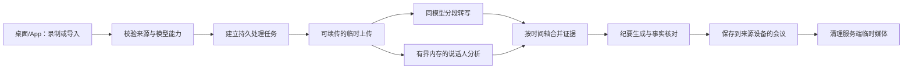

# VINote 长录音转写完整改造方案（2026-10-13）

状态：客户端改造已实施，完整长录音与飞书交付仍待验收。下方早期调查按发生时间保留，不代表线上服务最新能力；任务期间不得自动切换用户选择的语音模型。

## 本轮实施与实测更新

- 2026-10-14 追加：完整 sherpa 检测与 refinement 已移入单个隔离 spawn worker，memmap 输入与有界进度 IPC，父进程验证后保存证据，超时/死亡清理。20 秒真实原生模型诊断父循环最大间隔 0.051 秒，117 次心跳、5.946 秒结束、无残留子进程；未调用云 ASR/LLM。见[实际隔离证据](../reviews/2026-10-13-speaker-worker-gil.md)。
- 新任务保存账号绑定的 `model_source_snapshot.json`，具体模型及服务来源在恢复时沿用；真实 upload/direct-file router 测试均先写快照再写 request，变更全局设置不替换快照。旧无快照任务以 Sheet 明确确认当前显示的具体模型后 POST 同 task，不能推断历史模型。
- 主线程报告约 00:00 已在 Desktop native 核对原 50 分钟任务 Aliyun/Luna 一致并确认恢复。speaker 已缓存，正在 ASR，尚未完成完整 final、LLM 或纪要保存。运行期间禁止后端修改/reload，本 agent 不启动第二云 ASR。

- 桌面与 App 改用 VLA2 小帧、按音频时间节流的 WebSocket 传输；没有按模型名选择 12/60 秒的请求上限。传输帧大小是网络缓冲参数，不是模型时长限制。
- 只有服务明确返回 `audio_duration_exceeded` 和有效时长限制才调整当前未完成区间。普通断网、超时与 502 不推断限制、不切换模型。成功最终区间持久化；临时识别文字只展示进度。
- 录制时仅录制，停止后转写和独立说话人分析并行，两者完成后才调用 LLM。会议图示自动生成停止；旧产物可查看。
- 公网实际阿里云模型 `asr:6:aliyun:22:paraformer-realtime-v2` 在新适配器上完整通过 120 秒和 340 秒样本；340 秒返回最终 1454 字，覆盖到 340 秒。首次 340 秒连接中断后，取消短心跳收尾超时、保留独立接收截止时间，重测成功。单次成功不能证明所有网络环境和完整录音可靠。
- 本机 ViTalk 源码中的 300 秒限制不等于当前部署能力：线上实际单会话超过 300 秒成功，`/v1/models` 仍未声明限制，不能把源码常量写进 VINote。
- App 新增最终结果/正常关闭竞态、未发完提前返回、临时结果断连、帧长度测试。真实手机完整录音、火山模型及飞书联系人/位置交付需要分别验证；不以单元测试替代。
- 火山模型后续120秒真实调用已成功（484字），两个已配置模型均有实际最终结果证据。完整录音与手机端仍待验收；完整链路后台测试启动被自动审批拒绝，未执行。
- 独立审查追加修复了提前final、旧不完整transcript跳过核验、App pending无入口和读取后迟到发送边界。泛用HTTP分块不再切分VILab流式适配器，服务声明的会话限制由适配器管理。

## 早期调查事实（历史，已被上方实施更新替代）

本节的“当前”仅指调查当时。固定 12/60 秒 cap 已取消；本机源码中的 300 秒常量
不代表当前部署能力。下方步骤保留调查依据，不作为现行请求限制或上线验收结论。

- ViTalk 录制路径在开始时建立实时 ASR 会话，采音期间持续发送小 PCM 帧，并在结束时收取最终结果；连接或会话失败时保留录音，改走录后批量识别。VINote 当前长录音路径则反复调用独立的 `POST /v1/asr/transcriptions`，每个区间重新建立上游识别会话。两者不是同一传输与恢复语义。
- VILab 当前公开 WebSocket 实时协议在 `realtime/audio.rs` 限制单会话最多 300 秒、单帧最多 32,000 字节；这不是阿里云模型对整条录音的时长上限。长录音需要同模型的会话轮换或持久服务端作业、时间范围检查点和证据合并。
- 当前 VILab `/v1/models` 返回的两个 ASR 模型 `capabilities` 都是空对象，客户端无法据此得知可接受的单次音频时长、格式或请求大小。
- 真实 50 分 37 秒会议录音的 72 秒节选，经桌面端上传、8 次 12 秒以内转写、并行说话人分析和纪要生成成功；该测试不证明完整长录音能成功。一次 72 秒样本耗时约 122 秒。
- 阿里云与火山引擎的 8/12 秒 PCM WAV 已实测成功；曾有 60 秒请求返回 502。502 本身不证明音频过长，也可能是上游故障，因此不能仅凭 502 永久缩短分段或切换模型。
- 当前桌面和 App 按模型名决定 12/60 秒；这只是临时兼容逻辑，不应成为长期协议。
- VILab 的 HTTP 文件接口与 WebSocket 实时接口虽然共用 `/v1/asr/transcriptions` 路径，但实现不同：HTTP 路径把整份 WAV 解码后一次 `push_pcm(pcm_audio)` 送进阿里云 WebSocket 适配器；实时路径则接收连续小帧。HTTP 入口的 512 MiB 请求体限制不等于阿里云 WS 单帧或时长能力。大块一次发送是已确认的架构差异，是否正是那次 60 秒 502 的直接原因仍需带授权的分级实测和上游日志确认。
- 2026-10-13 公网 `wss://api.orulink.ai/v1/asr/transcriptions` 的匿名握手返回 401，确认入口可达且要求鉴权；本机现有服务密钥请求 LAN/公网模型目录都返回 401，因此本轮没有完成授权后的线上流式音频实测，不能宣称线上模型已成功转写长流。

## 目标行为

1. 录制/导入时不要求用户设置分段。处理开始时固定用户选择的 ASR 模型；失败和恢复均不自动换模型。
2. 服务的模型目录明确返回 `audio_input` 能力：接受的格式、建议单次时长、最大时长/字节数和能力修订。客户端只使用服务声明且在本端支持的格式与范围；新旧服务协议不兼容时采取保守安全值并说明性能影响。
3. 服务错误区分 `audio_too_long`、`payload_too_large`、`rate_limited`、`provider_unavailable`、`authentication_failed`、`no_speech`。仅明确的大小/时长错误允许同模型缩小当前未完成区间；普通 502/超时只有限重试，不推断模型能力。
4. 检查点以原音频起止时间、源文件指纹、模型 ID、能力修订和已确认正文保存，而非仅靠固定分段索引。分段变化后仍能准确复用覆盖的时间区间，不能重复、遗漏或把旧模型文字混入新模型结果。
5. 进度按已保存且连续覆盖的录音秒数计算。失败显示原模型、已完成范围和下一步；原音频、已生成版本及成功区间保留。

## 早期实施建议与验收（历史方案）

1. 先给 VILab 模型目录和转写错误补可验证的能力/错误协议，并用短、长、静音、超限样本确认真实返回；当前空 `capabilities` 不能冒充已支持。确认实时接口与文件接口各自的持续时间和失败语义。
2. 先修 VILab HTTP 桥接的整段 PCM 单帧发送：按阿里云适配器要求把 PCM 送成小帧，并验证是否需要按真实时间节流；用相同模型对 12、30、60、120 秒样本比较 HTTP 桥接与实时协议的返回和日志。然后长录音采用可恢复的服务端作业或按服务能力轮换的实时会话：原文件按时间范围送入选定模型，服务端确认并持久化已完成范围；中断只补传未确认范围。不能仅延长 HTTP 超时或把整条录音交给一个受 300 秒上限约束的公开 WebSocket 会话。
3. 桌面与 App 使用同一协议和相同的区间/检查点规则，保留旧检查点的安全迁移；先补区间合并与中断恢复测试，再改分段调度。说话人分析与 ASR 各有进度和证据，纪要只在必需证据齐备后生成。
4. 用同一段真实会议音频分别验证不同模型、短请求成功、明确超限后同模型降档、普通 502 不误判、离线恢复、无重复提交及纪要证据时间戳。手机上的原生文件处理和完整长录音必须另行实机核验。

在上述协议就绪前，不应把按模型名写死的 12/60 秒称为“自适应”，也不应把短样本成功称为长录音验收完成。

## 早期路径对比（历史分析）

调查当时，ViTalk 在录制中持续发送小 PCM 帧，VINote 对既有录音反复发起独立文件转写请求；该路径差异不能归因为阿里云模型本身不支持长录音。现行 VINote 已改为录后节流流式路径。历史 300 秒源码常量及一次 60 秒请求的 502 均不能用于判定当前部署限制；只有服务明确的能力/错误与实际样本可提供对应证据。

## 产品边界与推荐架构

推荐公网 VINote 处理服务采用持久队列、独立 worker 和私有临时媒体存储。它只处理本次任务，**不恢复跨设备会议与笔记同步**：原音视频默认留在来源设备；生成的纪要、逐字稿、说话人证据和版本由当前设备领取并保存。服务端临时副本用于后台继续处理，不变成另一台设备可浏览的文件库。任务完成或取消后按策略清理；建议终态 24 小时内清理、失败任务至多保留 7 天供恢复，实施时将期限做成受控配置并在界面说明。上传使用账号鉴权、TLS、私有存储、单任务授权与哈希校验，不在日志记录媒体或凭证。若媒体尚未传完而 App 退出，下次仅补传缺口；传完后服务 worker 可以独立继续。过期前应提醒领取结果，过期后明确说明需重新处理。

录制期间仅保存录音，不启动实时转写预览。结束后转写与说话人分析并行，必要证据齐备后生成纪要。录后流式路径不预设固定会话秒数；只根据服务明确声明的能力或有效结构化超限错误调整未完成范围。文件接口使用它自身声明的能力限制。恢复只使用**同一模型**补齐未确认区间。需要按实时速度喂帧的模型按要求节流，不能用倍速假设给出不实 ETA。

## 服务协议与作业数据

VILab `/v1/models` 应为每个 ASR 模型明确声明 `audio_input`：可用传输方式、编码/采样率/声道、单次大小与时长限制、建议窗口和重叠、帧速率要求、并发/限流及 `capability_revision`。数值分为经验证硬限制、推荐值和未知；未知时使用保守兼容值并显示可能较慢。客户端不再按模型名称写死 12/60 秒。

标准错误至少区分：`audio_too_long`、`payload_too_large`、`unsupported_format`、`rate_limited`、`provider_unavailable`、`auth_failed`、`quota_exhausted`、`no_speech`、`internal_error`，带可重试性、可选 `retry_after` 和不含密钥的诊断 ID。只有明确的时长/大小错误可让当前未完成区间在**同模型**下缩短；502、超时、断线仅有限退避重试，不据此改写模型能力。身份/额度问题暂停等待用户操作；静音区间记录为无语音而非空文字成功。远程结果不确定时先按操作 ID 查询，再决定补发；外部供应商调用无法保证计费意义上的恰好一次。

建议增加 `/api/processing-jobs`：创建（客户端幂等键）、分片上传与确认、启动、按 ID/事件游标查询、暂停/继续、取消、领取结果、清理临时媒体。保留旧 `/api/task/{id}` 的历史查询，不把旧任务伪装成新协议成功。作业持久化账号和设备、源文件指纹与总时长、选定模型/能力修订、阶段状态与尝试次数、已确认上传字节、ASR 和说话人时间范围、结果修订。每段文本以原音频起止毫秒、音频哈希、模型 ID、能力修订和稳定 segment ID 保存。合并前检测空洞与重复；重叠区只用于对齐，不重复输出文字。源文件或模型改变即新建作业，旧证据不能混入。

服务端限制同时转写区间、上传并发、单账号队列和 worker 内存；音频转换用流或临时文件，避免 App 解码并持有 78 分钟完整 PCM。说话人分析和 ASR 可并行，但分别提交检查点；短句、重叠和低置信片段允许“未知说话人”，会议内编号不冒充真实身份。纪要只在必要证据完整、时间轴无洞后生成与事实核对，并保存为新版本，不覆盖已保存版本。

## 两端完整交互

会议入口仅接录音、录屏、导入音视频或逐字稿；网页、PDF、Word、视频链接属于笔记。文件库管理来源原件及关联会议/笔记，来源和生成内容不混为一层。提交前显示来源、时长/大小、选定模型、预估上传量和联网要求。返回会议列表不取消作业；取消任务、删除会议、删除原件分别说明影响范围。

状态按已确认工作显示：`校验来源 → 上传 x/y MB → 排队 → 转写 hh:mm:ss/总时长 → 识别说话人 hh:mm:ss/总时长 → 整理/核对纪要 → 保存完成`。转写进度只计入已持久化且连续覆盖的音频时间，上传按已确认字节，不能用“当前阶段由服务处理，完成后更新实际进度”占位。无可测分母的总结阶段显示完成步骤和当前动作，不伪造百分比。ETA 在缺少速率样本时显示“估算中”。

失败时显示阶段、选定模型、已完成时间、明确原因、自动等待或“继续处理”入口和诊断 ID；继续只补未确认区间。断网、前后台切换、桌面重启后按 job ID 取回状态；源文件缺失或变化时提示重新选择。账号/额度问题等待用户解决而不自动改模型。会议详情可查看纪要、逐字稿、说话人、全部版本及处理记录；处理记录展示来源位置、阶段和尝试次数，底层协议与存储地址只放折叠诊断信息。所有页面保留可理解的返回入口。

## 实施顺序

1. **观测与协议**：VILab 补模型能力、结构化错误、操作查询与长短/静音/超限探针；对 502 留诊断 ID。确认实时和文件接口各自限制。
2. **持久作业**：实现私有临时上传、队列/worker、区间检查点、幂等创建、结果领取、清理和配额。旧检查点只在来源指纹及模型完全匹配时迁移；不匹配则保留原件并新建作业。
3. **桌面与 App**：共用状态契约与区间合并规则，分别实现文件上传和前后台恢复。保证录后/导入长音频可靠；录制期间仅录制，不自动转写。失败绝不自动切换模型；用户主动换模型需显式新建任务。
4. **说话人和纪要**：有界内存证据处理、时间戳对齐、无洞校验、事实核对、版本保存；修复原件管理与纪要的删除边界。
5. **灰度与回滚**：内部账号先跑完整样本，再开放。回滚时关闭新建入口但保持既有新任务查询与结果领取，不丢检查点。

## 完成定义

用四条完整样本（50:37 m4a、28:07 mp4、1:18:10 与 22:57 手机录音）实际跑通适用的桌面/App 流程，核对末尾覆盖、非静音时间轴无洞无重复、说话人时间戳、纪要保存/编辑/导出与原件保留。72 秒节选成功不算长录音验收。分别注入断网、后台、桌面/worker 重启、429、502、超时、明确超限、额度不足、源文件变化、分片损坏、静音；核对状态、同模型有限重试、续传位置及无重复会议/版本。记录各阶段耗时、请求数、重试数、手机和 worker 峰值内存，先建立基线再定性能目标。验证不同账号隔离、临时媒体到期清理、无跨设备内容同步。证据分别记录接口测试、真实 VILab 调用、桌面窗口操作和 Android 实机操作；未跑通的额度或供应商故障如实列为阻断，不以自动换模型掩盖。
