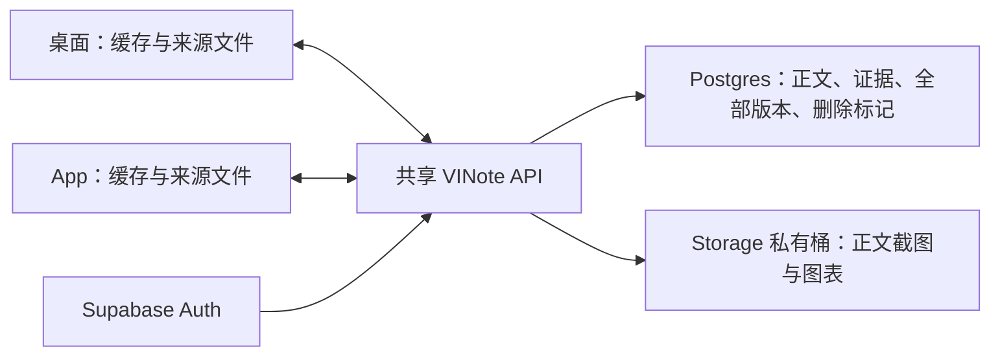

# 历史方案：同账号跨设备内容同步

> 本页为历史审查记录。仓库源码位置以路径标注，不作为文档站页面链接；历史行号可能随修改变化。

> 当前产品已取消跨设备内容同步。桌面与 App 保存、编辑、回收、恢复及导出当前设备上的内容，不派发 workspace 拉取、推送或后台重试。账号登录、用户明确确认的飞书发布和 MCP 调用独立保留。本文记录历史服务/API 与恢复约束，不代表当前客户端功能或新的部署要求。

用户确认的“共享”是手机和桌面使用同一个 VINote 账号，读写同一个 HTTPS 内容服务。不同账号的数据隔离；飞书是发布目的地，不承担 VINote 同步。

## 数据边界

正文、全部版本、逐字稿、说话人别名和时间轴、项目标签、归档与回收站同步。原始录音、录屏和导入音视频默认留在来源设备；另一设备能读纪要，但没有来源文件时不能播放或重新转写。录制设备设置与目录不参与内容同步。飞书和 MCP 凭证仅由服务端加密保存。

客户端先保存本地内容，再上传正文图片，最后提交正文及版本。服务端回执成功后才显示已同步。图片保留 `attachment://<sha256>` 引用，不把短期签名地址写进正文；读取时取得五分钟访问地址。仅接受 5 MB 以内的静态 PNG/JPEG/WebP，不接受原始音视频或 SVG。

写入带操作 ID 和预期 revision。重复请求复用回执；冲突保留本地草稿；删除写 tombstone，不删除来源文件或飞书文档。图片失败时保留正文并显示失败；同条内容不能因此显示已同步。

目前客户端通过分页摘要检查 revision，只读取变化的详情、只提交变化的内容。尚未实现服务端变更游标或实时通知；不能称为完整的增量订阅同步。正文附件目前需要联网读取，尚未实现可保证离线可用的持久图片缓存。

## 部署准备

部署目录为 `deploy/workspace`。将 `cloud.env.example` 复制为忽略提交的 `cloud.env`，由管理员配置固定 HTTPS 域名、Postgres、Supabase Auth 与 Storage 服务端密钥。禁止将密钥放进 App、前端或聊天。

1. 管理员一次配置 Postgres 连接、现有 Supabase 的公开密钥和 Storage 服务端密钥，并持久保存应用加密密钥。使用独立 VINote 数据库；数据库角色须拥有 VINote 表或相应服务端 RLS 权限。
2. 运行 `docker compose -f deploy/workspace/compose.yml up --build -d`。启动自动在同一数据库事务中建表、启用 RLS 并撤销 PUBLIC/anon/authenticated 的直接表访问，覆盖 VINote 注册的全部表，包括飞书与 MCP 凭证表。自动创建私有正文图片桶、配置大小和类型限制；已存在的公开桶会使启动失败，不自动改变其公开属性。初始化失败不能通过健康检查。无需另外手工执行建表和建桶步骤。
3. 检查已有 Storage policies，确保没有覆盖该桶的宽泛公开/跨账号读取规则；初始化不会删除其它应用的策略。已有 SQLite 数据迁移单独验证，不自动覆盖云端数据。
4. 在既有 HTTPS 反向代理后提供服务；本机映射 8910 只绑定 loopback。反向代理限制正文图片请求为 6 MB，并配置请求超时与速率限制。桌面 `VINOTE_WORKSPACE_URL` 与 App 发布配置的 `integrationBaseUrl` 使用同一共享 API 域名；Supabase 地址继续用于账号和数据存储。
5. 部署后验证 A/B 账号隔离、跨端编辑/版本/冲突/回收站、图片失败与签名过期，以及电脑关闭后 App 的读取和编辑。开发 App 仍经 USB 连接本机 8900。

`VINOTE_WORKSPACE_CLOUD=true` 时要求 PostgreSQL、Supabase Auth 和 HTTPS 私有附件配置，不回退 SQLite 或本机附件。共享服务只注册 workspace、Feishu 和 MCP 相关 API，不注册本地原件、媒体上传、Cookie 账号及公开分享 API。原件 API `/api/files` 仅在设备本地服务提供。

服务端表加密所需 `MODEL_PROFILE_ENCRYPTION_KEY`、JWT 密钥需要持久保管，不能每次部署更换。服务端密钥、数据库与私有桶需要独立备份；目前未实现附件孤儿回收策略，不应提前清理仍被历史版本引用的图片。

## 当前状态

2026-10-11 最新：共享 API 已部署到 `https://supabase-vinote.orulink.ai/vinote-api`，使用现有 VINote Supabase 内独立 `vinote_workspace` schema 和私有 `vinote-content` 桶。外部健康检查 200，无凭证内容请求 401。部署脚本使用既有管理员仅做 schema 初始化，API 仍为有限专用角色；Storage 兼容旧版 400／404 缺失响应。临时单 IP SSH 规则已撤销并核验为空。详见现有服务器记录的最新状态。

2026-10-12：桌面开发端与 Android App 的 workspace、Feishu 和 MCP 已切至同一个公网 API。已实测桌面公开网页/PDF 生成后在手机读取、手机 DOCX 生成后在原生桌面读取，桌面显示服务回执“已同步”。开发 App 的来源生成仍由 USB 本机 8900 处理；该生成依赖不等同于内容同步依赖。发布 App 的远程来源生成地址尚未配置，不应将这些样本称为发布版无电脑生成验收。并发冲突、跨端删除恢复、附件过期及断网边界仍按独立清单验收。

下面保留部署前观察供追溯，不作为当前服务器未上线的结论。

用户已指定数据存储实例 `https://supabase-vinote.orulink.ai`。该实例已经是两端的账号认证地址；只读健康检查 HTTP 200。对 `/rest/v1/workspace_notes?select=key&limit=0` 的公开密钥请求为 404，尚不能确认同步表已建立；没有用公开密钥写入或迁移。Storage 桶目录请求为 400，不能据此声称私有桶已配置。需要数据库连接与服务端存储凭证完成正式部署；公开 publishable key 不替代它们。

已加入私有附件接口、云端启动约束、事务内表权限初始化、自动私有桶初始化与容器部署配置；本地回归覆盖附件账号隔离、重试、类型校验、原件边界及存储初始化失败。AWS 核验已完成：此 Supabase 实例位于现有香港 EC2，受限服务端凭证已在服务器，无需用户另找数据库密码。部署方案见 现有服务器记录（源码位置：`deploy/workspace/aws-existing-server.md`）。源码包已经上传 AWS CloudShell，但 EC2 安全组不允许该传输来源，正等待临时单 IP SSH 规则确认；未修改安全组、部署 API、迁移真实数据或验收跨公网同步。当前开发环境仍为电脑 SQLite 服务。真实 PostgreSQL 权限与 Storage 初始化尚未上线验证。
